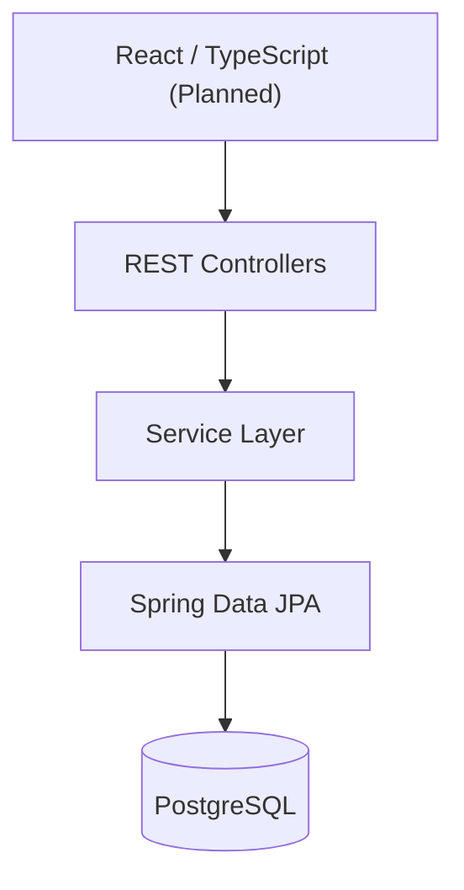

# Help Desk Ticketing System

A RESTful help desk ticket management application built with Java, Spring Boot, and PostgreSQL.

This project is designed to simulate an IT support environment, allowing support tickets to be created, tracked, updated, and managed through a backend API.

## Tech Stack

**Backend**
- Java 21
- Spring Boot
- Spring Data JPA / Hibernate
- PostgreSQL
- Maven

**API and Documentation**
- RESTful API
- Jakarta Bean Validation
- Springdoc OpenAPI / Swagger UI

**Frontend (Planned)**
- React
- TypeScript

## Features

- Create help desk tickets with a title, description, and priority
- Manage ticket statuses: OPEN, IN_PROGRESS, RESOLVED, CLOSED
- Assign priority levels: LOW, MEDIUM, HIGH, URGENT
- Persist ticket information in PostgreSQL
- Separate application logic into controller, service, and repository layers
- Validate incoming requests using DTOs and Jakarta Bean Validation
- Handle missing tickets with custom exception handling
- Document API operations using OpenAPI annotations

## Architecture

The backend follows a layered architecture to separate HTTP request handling, business logic, and database operations.



## Project Structure

```text
src/main/java/com/anthonyk/Helpdesk/
├── controller/
├── service/
├── repository/
├── model/
├── dto/
├── exception/
└── docs/
```

## Getting Started

### Prerequisites

- Java 21
- PostgreSQL
- Maven or the included Maven wrapper

### Local Setup

1. Clone the repository.
2. Configure your PostgreSQL connection using the application's configuration and environment variables.
3. Ensure your database is available.
4. Run the Spring Boot application using the Maven wrapper.

**Windows**
```bash
mvnw.cmd spring-boot:run
```

**macOS / Linux**
```bash
./mvnw spring-boot:run
```

Database credentials should be provided through environment variables and should never be committed to version control.

## Future Improvements

- [ ] React and TypeScript frontend
- [ ] User authentication and authorization
- [ ] Automated unit and integration tests
- [ ] Continuous integration using GitHub Actions
- [ ] Deployment and live demonstration

## Project Goals

The purpose of this project is to strengthen my understanding of backend software engineering, database persistence, REST API design, application architecture, and eventually full-stack development.

Built as an independently developed portfolio project.
